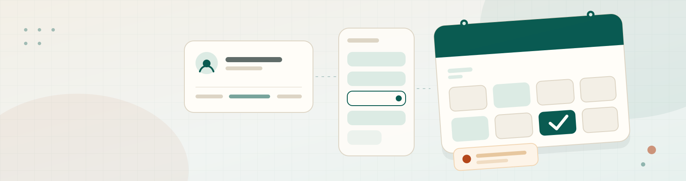

<div align="center">



# نوبت

**نوبت‌دهی چند-مستأجری برای مطب‌های کوچک**

[](https://dotnet.microsoft.com/)
[](https://www.microsoft.com/sql-server)
[](https://vuejs.org/)
[](#چه-کاری-می‌کند)

</div>

منشی مطب ساعت کاری پزشک را می‌چیند، بیمار از لینک مطب وقت خالی را می‌بیند و با یک کد پیامکی نوبت می‌گیرد. هر مطب دادهٔ خودش را دارد و در سطح کوئری از بقیه جدا می‌شود. پنل فارسی و راست‌به‌چپ است و روی یک SQL Server اجرا می‌شود — همان چیزی که در مطب‌های ایران در دسترس است.

پنل، پرسنل، خدمات، ساعت کاری، اسلات آزاد و رزرو با کد یک‌بارمصرف کار می‌کنند (۱۲۹ تست). تقویم شمسی پنل، لغو/جابه‌جایی نوبت و استقرار مراحل بعدی‌اند.

## چه کاری می‌کند

- **چند-مستأجری واقعی** — یک دیتابیس، `TenantId` روی همهٔ جدول‌ها، فیلتر سراسری EF Core و `SaveChangesInterceptor`. تست‌های ایزولاسیون با دو مطب در CI اجرا می‌شوند؛ پرسنل مطب A برای مطب B نه دیده می‌شود نه قابل ویرایش است.
- **پنل مطب** — ثبت مطب، ورود با کوکی، پرسنل، خدمات (مدت و قیمت)، و ساعت کاری هفتگی با چند بازه در روز. هفته از شنبه شروع می‌شود و روز بدون بازه «تعطیل» است.
- **اسلات آزاد** — محاسبه در `SlotPolicy`، بدون دیتابیس و ساعت سیستمی: گام ۱۵ دقیقه، بدون شروع تا نیم‌ساعت آینده، افق ۶۰ روز. نوبت رزروشده از فهرست حذف می‌شود.
- **رزرو عمومی** — صفحهٔ `/b/{slug}`: خدمت، پزشک، روز، ساعت، بعد نام و شماره. قبل از ثبت، یک کد شش رقمی به موبایل بیمار می‌رود؛ کد هش می‌شود، دو دقیقه اعتبار دارد، پنج تلاش و یک بار مصرف. دو بیمار که هم‌زمان یک ساعت را بزنند: یکی ۲۰۱، دیگری پیام «پر شد».
- **خطاها قابل‌برنامه‌نویسی‌اند** — `ProblemDetails` با `type` ثابت (`staff.not_found`، `working_hour.overlap`، `request.invalid`، `appointment.slot_taken`، `otp.expired`)، نه متن فارسی برای پارس‌کردن.
- **رابط کاربری** — Vue 3 + Vite بدون کتابخانهٔ UI، توکن‌محور، فونت وزیرمتن به‌صورت لوکال (بدون CDN)، ارقام فارسی و قیمت به تومان.

## اجرا

نیاز: .NET SDK 10، Node.js 24 و یک SQL Server. روی ویندوز، SQL Server Express LocalDB کافی است و در حالت `Development` خودکار وصل می‌شود.

```bash
# ابزار مایگریشن (یک‌بار)
dotnet tool restore

# دیتابیس
dotnet tool run dotnet-ef database update -p src/Nobat.Infrastructure -s src/Nobat.Api

# API + پنل
dotnet run --project src/Nobat.Api   # http://localhost:5080
```

اولین بار در `/login` تب «ثبت مطب» را بزنید؛ همان حساب، صاحب مطب می‌شود. صفحهٔ بیمار روی `/b/{slug}` است و دکمهٔ «صفحهٔ رزرو» در پنل همان را باز می‌کند.

در حالت `Development` کد تأیید هم روی صفحه نشان داده می‌شود و هم در لاگ، تا بدون سرویس پیامک بتوانید رزرو را امتحان کنید. در محیط واقعی `Sms:ExposeCodeInResponse` خاموش است و کد فقط پیامک می‌شود.

برای کار روی رابط کاربری با hot reload:

```bash
cd web
npm ci
npm run dev        # http://localhost:5173 با پروکسی به 5080
```

اگر SQL Server جای دیگری است، رشتهٔ اتصال را از محیط بدهید:

```powershell
$env:ConnectionStrings__Default = "Server=localhost,1433;Database=Nobat;User Id=sa;Password=…;TrustServerCertificate=True"
```

تست‌های یکپارچه به یک SQL Server واقعی نیاز دارند: `NOBAT_TEST_SQL` را ست کنید، وگرنه از LocalDB استفاده می‌کنند. هر اجرا یک دیتابیس موقت می‌سازد و در پایان حذف می‌کند.

```bash
dotnet test Nobat.slnx
dotnet format Nobat.slnx --verify-no-changes
```

## ساختار

```text
src/
  Nobat.Domain/          موجودیت‌ها و قواعد خالص (SlotPolicy، ساعت کاری، تلفن ایرانی)
  Nobat.Application/     use-case‌ها روی IApplicationDbContext فیلترشده
  Nobat.Infrastructure/  EF Core، مایگریشن‌ها، فیلتر مستأجر، interceptor
  Nobat.Api/             Minimal API، کوکی، میان‌افزار مستأجر، wwwroot
tests/
  Nobat.UnitTests/       قواعد دامنه
  Nobat.IntegrationTests/ SQL Server واقعی، دو مطب، همزمانی
web/                     Vue 3 + Vite + TypeScript (خروجی در wwwroot)
docs/                    بنر و تصاویر
```

قاعدهٔ وابستگی: Domain به هیچ‌چیز، Application به Domain، Infrastructure به هر دو، Api به Application. هر endpoint فقط ورودی می‌خواند، یک use-case صدا می‌زند و نتیجه را برمی‌گرداند؛ منطق در Application و Domain است.

مسیرهای اصلی: `/api/auth/*` (ثبت مطب، ورود، خروج)، `/api/staff`، `/api/services`، `/api/staff/{id}/working-hours` برای پنل، و برای بیمار `/api/public/{slug}`، `/slots`، `/otp` و `/appointments`.

## وضعیت

- کار می‌کند: پنل مطب، پرسنل، خدمات، ساعت کاری، اسلات آزاد، رزرو عمومی با کد تأیید، ایزولاسیون مستأجر.
- در نوبت بعد: تقویم شمسی در پنل منشی، لغو و جابه‌جایی نوبت، یادآوری پیامکی، استقرار.

## تماس

- گیت‌هاب: [sepehrsdq](https://github.com/sepehrsdq)
- ایراد یا پیشنهاد: [issues همین ریپو](https://github.com/sepehrsdq/Nobat/issues)

## لایسنس

نرم‌افزار اختصاصی؛ همهٔ حقوق محفوظ است. استفاده، بازتوزیع یا انتشار مجدد فقط با اجازهٔ کتبی مالک. جزئیات در [`LICENSE`](LICENSE).

<div align="center"><sub>© ۲۰۲۶ سپهر صدیق</sub></div>
